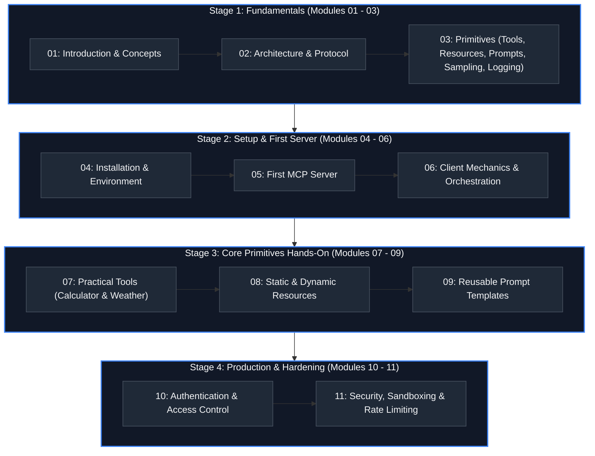

# 🧭 Model Context Protocol (MCP) — Comprehensive Learning Index

> **Your Complete Master Navigation Guide to all 11 Modules, 50+ Lessons, and Hands-on Server Implementations.**

---

## 🗺️ Master Curriculum Index

---

## 📚 Complete Module & Lesson Breakdown

### 🟢 Stage 1: Conceptual Foundations & Architecture

#### [Module 01 — Introduction](./Module%2001%20Introduction/00%20Overview.md) `Beginner`
*Foundational concepts of the Model Context Protocol, the problems solved, and agentic integrations.*
- [00 Overview](./Module%2001%20Introduction/00%20Overview.md): Course orientation, prerequisites, and learning objectives.
- [01 What is MCP?](./Module%2001%20Introduction/01%20What%20is%20MCP.md): Protocol definition, the USB-C analogy, and core advantages.
- [02 MCP Architecture](./Module%2001%20Introduction/02%20MCP%20Architecture.md): Host, Client, and Server roles and relationships.
- [03 History & Evolution](./Module%2001%20Introduction/03%20History%20&%20Evolution.md): From brittle ad-hoc connectors to an open universal standard.
- [04 Why MCP?](./Module%2001%20Introduction/04%20Why%20MCP.md): Developer ROI, security boundaries, and enterprise readiness.
- [05 AI Tool Calling](./Module%2001%20Introduction/05%20AI%20Tool%20Calling.md): Mechanics of how LLMs decide to invoke tools via JSON Schema.
- [06 AI Agents & MCP](./Module%2001%20Introduction/06%20AI%20Agents%20&%20MCP.md): Dynamic discovery, multi-turn reasoning loops, and autonomous workflows.
- [07 Context in Modern AI Systems](./Module%2001%20Introduction/07%20Context%20in%20Modern%20AI%20Systems.md): Context window management, token budgeting equations, and state transfer.
- [08 Official Resources](./Module%2001%20Introduction/08%20Official%20Resources.md): Curated documentation, official repositories, and SDK links.

#### [Module 02 — MCP Architecture](./Module%2002%20-%20MCP%20Architecture/README.md) `Beginner-Intermediate`
*High-level protocol design, JSON-RPC 2.0 message contracts, and transport performance modeling.*
- [Module 02 Architecture Guide](./Module%2002%20-%20MCP%20Architecture/README.md): Host-Client-Server topology, STDIO vs. Streamable HTTP/SSE transports, round-trip latency modeling, and JSON-RPC reliability formulas.

#### [Module 03 — MCP Components](./Module%2003%20-%20MCP%20Components/README.md) `Intermediate`
*The five core primitives that define the protocol specification.*
- **Tools:**
  - [01 Tools — Theory](./Module%2003%20-%20MCP%20Components/01%20MCP%20Tools/01_MCP%20Tools%20-%20Theory.md): Schemas, validation rules, and error envelopes.
  - [02 Tools — Architecture](./Module%2003%20-%20MCP%20Components/01%20MCP%20Tools/02_MCP%20Tools%20-%20Architecture.md): Internal server tool registry and dispatcher.
  - [03 Tools — Communication Flow](./Module%2003%20-%20MCP%20Components/01%20MCP%20Tools/03_MCP%20Tools%20-%20Communication%20Flow.md): `tools/list` and `tools/call` JSON-RPC message traces.
- **Resources:**
  - [01 Resources — Theory](./Module%2003%20-%20MCP%20Components/02-Resources/01_MCP%20Resources%20-%20Theory.md): Passive context sharing, URIs, and resource templates.
  - [02 Resources — Architecture](./Module%2003%20-%20MCP%20Components/02-Resources/02_MCP%20Resources%20-%20Architecture.md): URI routing and data stream boundaries.
  - [03 Resources — Flow](./Module%2003%20-%20MCP%20Components/02-Resources/03_MCP%20Resources%20-%20Flow.md): `resources/list`, `resources/read`, and subscriptions.
- **Prompts:**
  - [01 Prompts — Theory](./Module%2003%20-%20MCP%20Components/03-Prompts/01_MCP%20Prompts%20-%20Theory.md): Server-hosted workflows and parameterized prompt templates.
  - [02 Prompts — Architecture](./Module%2003%20-%20MCP%20Components/03-Prompts/02_MCP%20Prompts%20-%20Architecture.md): Template compilation and multi-turn message assembly.
  - [03 Prompts — Flow](./Module%2003%20-%20MCP%20Components/03-Prompts/03_MCP%20Prompts%20-%20Flow.md): `prompts/list` and `prompts/get` request cycles.
- **Sampling:**
  - [01 Sampling — Theory](./Module%2003%20-%20MCP%20Components/04-Sampling/01_MCP%20Sampling%20-%20Theory.md): Server-initiated model completions, temperature formulas, and user consent.
  - [02 Sampling — Architecture](./Module%2003%20-%20MCP%20Components/04-Sampling/02_MCP%20Sampling-Architecture.md): Host delegation, security policies, and permission gating.
  - [03 Sampling — Flow](./Module%2003%20-%20MCP%20Components/04-Sampling/03_MCP%20Sampling%20-%20Flow.md): `sampling/createMessage` message sequence.
- **Logging:**
  - [01 Logging — Theory](./Module%2003%20-%20MCP%20Components/05-Logging/01_MCP%20Logging%20-%20Theory.md): Diagnostic notification streams and log levels.
  - [02 Logging — Architecture](./Module%2003%20-%20MCP%20Components/05-Logging/02_MCP%20Logging%20-%20Architecture.md): Out-of-band logging pipelines.
  - [03 Logging — Flow](./Module%2003%20-%20MCP%20Components/05-Logging/03_MCP%20Logging%20-%20Flow.md): `notifications/message` sequence and filtering.
- **Roots & Advanced Capabilities:**
  - [Roots, Progress, Cancellation & Completions Guide](./Module%2003%20-%20MCP%20Components/06-Roots-and-Advanced-Capabilities/README.md): Workspace roots (`roots/list`), progress reporting (`notifications/progress`), request cancellation (`notifications/cancelled`), argument completions (`completion/complete`), and ping liveness checks.

---

### 🟡 Stage 2: Environment Setup, First Server & Client Mechanics

#### [Module 04 — Installation](./Module%2004%20-%20Installation/Installation.md) `Beginner`
*Comprehensive environment setup across operating systems, language runtimes, container engines, and AI hosts.*
- [Installation Guide](./Module%2004%20-%20Installation/Installation.md): Node.js 18+, Python 3.10+, Docker, VS Code, Claude Desktop, Cursor AI, and OpenAI integration.

#### [Module 05 — Setting Up Your First MCP Server](./Module%2005%20-%20Setting%20Up%20Your%20First%20MCP%20Server/README.md) `Beginner-Intermediate`
*Hands-on server creation, SDK installation, tool registration, and local testing.*
- [Module 05 Guide](./Module%2005%20-%20Setting%20Up%20Your%20First%20MCP%20Server/README.md): Step-by-step tutorial to create a functional server.
- **01 Environment Setup:**
  - [Setup Hub](./Module%2005%20-%20Setting%20Up%20Your%20First%20MCP%20Server/01-Environment-Setup/README.md)
  - [Node.js Installation](./Module%2005%20-%20Setting%20Up%20Your%20First%20MCP%20Server/01-Environment-Setup/NodeJS-Installation.md)
  - [Python Installation](./Module%2005%20-%20Setting%20Up%20Your%20First%20MCP%20Server/01-Environment-Setup/Python-Installation.md)
  - [Recommended VS Code Extensions](./Module%2005%20-%20Setting%20Up%20Your%20First%20MCP%20Server/01-Environment-Setup/VSCode-Extensions.md)
- **02 Installing MCP SDK:**
  - [SDK Hub](./Module%2005%20-%20Setting%20Up%20Your%20First%20MCP%20Server/02-Installing-MCP-SDK/README.md)
  - [Node.js SDK](./Module%2005%20-%20Setting%20Up%20Your%20First%20MCP%20Server/02-Installing-MCP-SDK/NodeJS-SDK.md)
  - [Python SDK](./Module%2005%20-%20Setting%20Up%20Your%20First%20MCP%20Server/02-Installing-MCP-SDK/Python-SDK.md)
  - [Installation Commands Reference](./Module%2005%20-%20Setting%20Up%20Your%20First%20MCP%20Server/02-Installing-MCP-SDK/Installation-Commands.md)
  - [TypeScript Starter Server (`server.ts`)](./Module%2005%20-%20Setting%20Up%20Your%20First%20MCP%20Server/02-Installing-MCP-SDK/my-first-mcp-server/src/server.ts)
  - [Python Starter Server (`server.py`)](./Module%2005%20-%20Setting%20Up%20Your%20First%20MCP%20Server/02-Installing-MCP-SDK/my-python-mcp/server.py)

#### [Module 06 — MCP Client](./Module%2006%20-%20Client/README.md) `Intermediate`
*Client-side lifecycle, capability negotiation, tool execution, and retry management.*
- [Module 06 Client Hub](./Module%2006%20-%20Client/README.md): Client responsibilities, orchestration, and host bridges.
- [01 Client — Theory](./Module%2006%20-%20Client/01_MCP%20Client%20-%20Theory.md): Lifecycle stages, JSON-RPC protocol error codes, and exponential backoff with full jitter formula.
- [02 Client — Architecture](./Module%2006%20-%20Client/02_MCP%20Client%20-%20Architecture.md): Session state machines, transport multiplexers, and security boundaries.
- [03 Client — Flow](./Module%2006%20-%20Client/03_MCP%20Client%20-%20Flow.md): Complete initialization handshake and tool execution sequence diagrams.
- **Runnable Client Implementations:**
  - [Python Client Guide & Code (`client.py`)](./Module%2006%20-%20Client/Python/README.md)
  - [TypeScript Client Guide & Code (`client.ts`)](./Module%2006%20-%20Client/TypeScript/README.md)

---

### 🟠 Stage 3: Core Primitives Hands-On Implementations

#### [Module 07 — MCP Tools](./Module%2007%20-%20Tools/README.md) `Intermediate`
*Practical, runnable implementations of MCP Tools in Python and TypeScript.*
- [Module 07 Tools Hub](./Module%2007%20-%20Tools/README.md): Tool overview and extended enterprise challenges.
- **01 Calculator Project:**
  - [Calculator Project Guide](./Module%2007%20-%20Tools/01-Calculator/README.md)
  - [Python Calculator Server (`server.py`)](./Module%2007%20-%20Tools/01-Calculator/Python/server.py)
  - [TypeScript Calculator Server (`server.ts`)](./Module%2007%20-%20Tools/01-Calculator/TypeScript/server.ts)
- **02 Weather Project:**
  - [Weather Project Guide](./Module%2007%20-%20Tools/02-Weather/README.md)
  - [Python Weather Server (`server.py`)](./Module%2007%20-%20Tools/02-Weather/Python/server.py)
  - [TypeScript Weather Server (`server.ts`)](./Module%2007%20-%20Tools/02-Weather/TypeScript/server.ts)

#### [Module 08 — Static & Dynamic Resources](./Module%2008%20-%20Resources/README.md) `Intermediate`
*Expose structured files, binary blobs, and databases as read-only model context.*
- [Module 08 Resources Hub](./Module%2008%20-%20Resources/README.md): Overview and learning outcomes.
- [Resources Theory Guide](./Module%2008%20-%20Resources/Theory.md): MIME types, resource templates, pagination, and token boundaries.
- [Python Resources Server (`server.py`)](./Module%2008%20-%20Resources/Python/server.py): Registers PDF, CSV, JSON, PNG, Markdown, and SQLite database resources.
- [TypeScript Resources Server (`server.ts`)](./Module%2008%20-%20Resources/TypeScript/server.ts): High-level `McpServer` resource declaration with mock dataset generation.

#### [Module 09 — Prompt Templates](./Module%2009%20-%20Prompt%20Templates/README.md) `Intermediate`
*Standardized prompt engineering workflows hosted on servers and discoverable by clients.*
- [Module 09 Prompts Hub](./Module%2009%20-%20Prompt%20Templates/README.md): Overview and learning outcomes.
- [Prompt Templates Theory Guide](./Module%2009%20-%20Prompt%20Templates/Theory.md): Multi-turn message structures, parameter interpolation, and versioning.
- [Python Prompts Server (`server.py`)](./Module%2009%20-%20Prompt%20Templates/Python/server.py): Production templates for Code Review, PR Review, Summarization, Meeting Notes, and Research.
- [TypeScript Prompts Server (`server.ts`)](./Module%2009%20-%20Prompt%20Templates/TypeScript/server.ts): Strongly typed prompt handlers with Zod schema argument validation.

---

### 🔴 Stage 4: Authentication, Security & Hardening

#### [Module 10 — Authentication & Access Control](./Module%2010%20-%20Authentication/README.md) `Advanced`
*Credential isolation, constant-time validation, OAuth tokens, and host secret injection.*
- [Module 10 Authentication Hub](./Module%2010%20-%20Authentication/README.md): Credential delegation pattern and learning objectives.
- [Authentication Theory Guide](./Module%2010%20-%20Authentication/Theory.md): API keys, timing attack resistance formula, OAuth code grants, and JWT validation.
- [Python Authentication Server (`server.py`)](./Module%2010%20-%20Authentication/Python/server.py): Demonstrates `hmac.compare_digest`, token verification, and environment boundaries.
- [TypeScript Authentication Server (`server.ts`)](./Module%2010%20-%20Authentication/TypeScript/server.ts): Demonstrates `crypto.timingSafeEqual`, simulated OAuth endpoints, and bearer token parsers.

#### [Module 11 — Security & Sandboxing](./Module%2011%20-%20Security/README.md) `Advanced`
*Defensive tool design, prompt injection mitigation, directory sandboxing, and token bucket rate limits.*
- [Module 11 Security Hub](./Module%2011%20-%20Security/README.md): Defensive architectures and security guarantees.
- [Security Theory Guide](./Module%2011%20-%20Security/Theory.md): Path traversal mitigation, preventing arbitrary `eval()`, Human-in-the-Loop (HITL) gates, and mathematical token bucket rate limiting.
- [Python Security Server (`server.py`)](./Module%2011%20-%20Security/Python/server.py): Bounded filesystem sandbox, safe AST calculator, and HITL write confirmations.
- [TypeScript Security Server (`server.ts`)](./Module%2011%20-%20Security/TypeScript/server.ts): Path resolution checks, containerized boundary assertions, and sanitized inputs.

---

## 🧭 Navigation Quick Links

- 🏠 **Root README:** [README.md](./README.md)
- ❓ **FAQs & Self-Assessment:** [FAQ-and-Self-Assessment.md](./FAQ-and-Self-Assessment.md)
- 🤝 **Contributing:** [CONTRIBUTING.md](./CONTRIBUTING.md)
- 📜 **License:** [LICENSE](./LICENSE)
