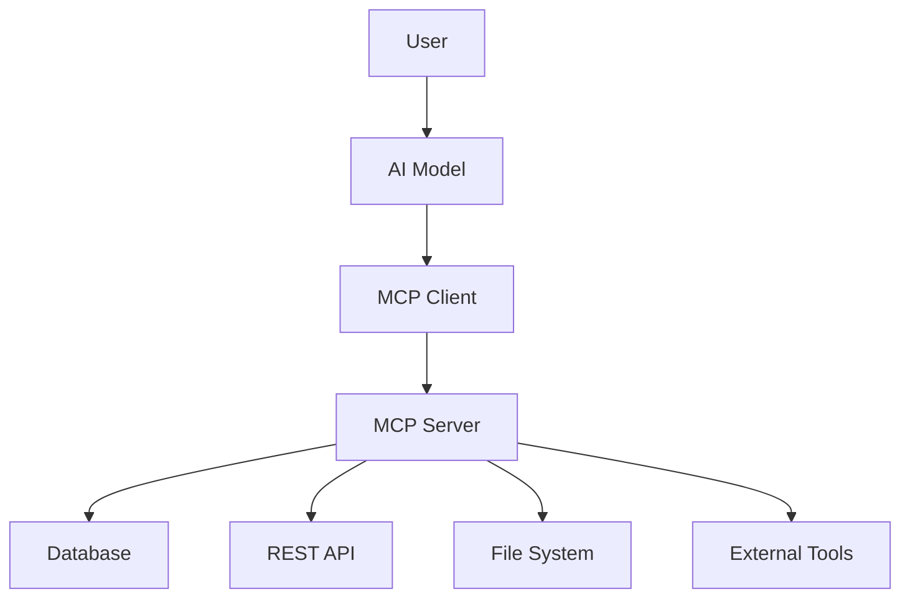
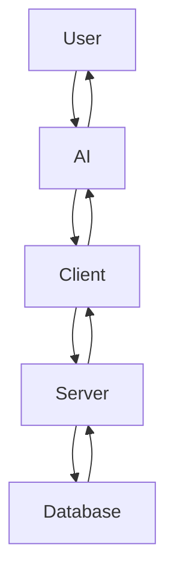
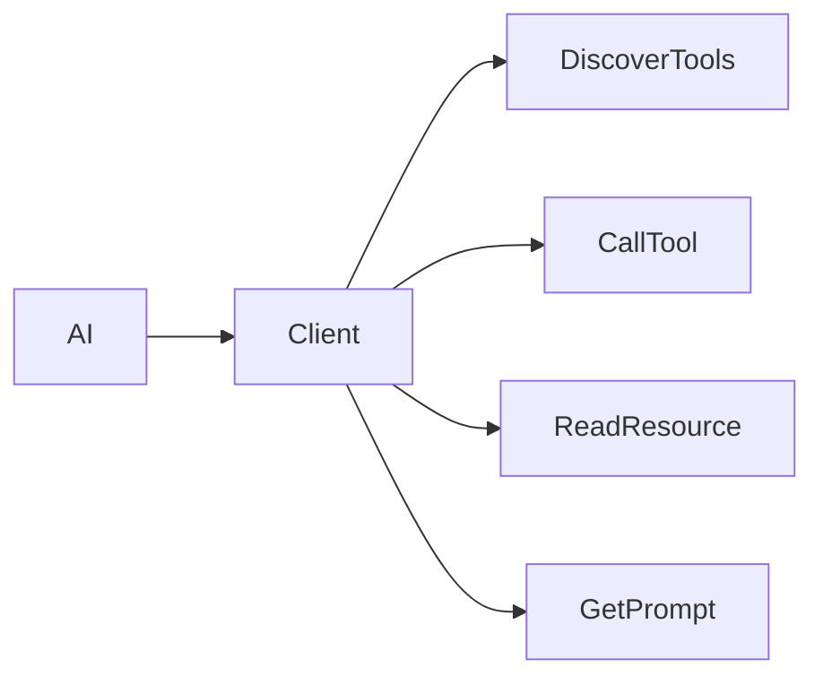
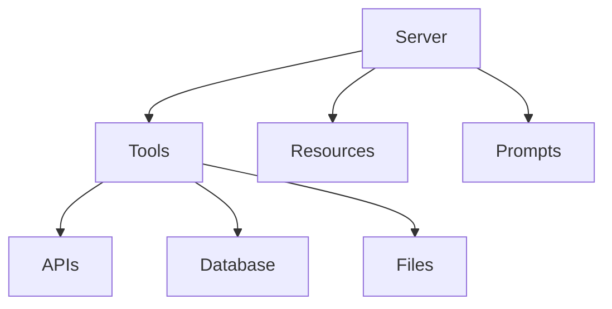
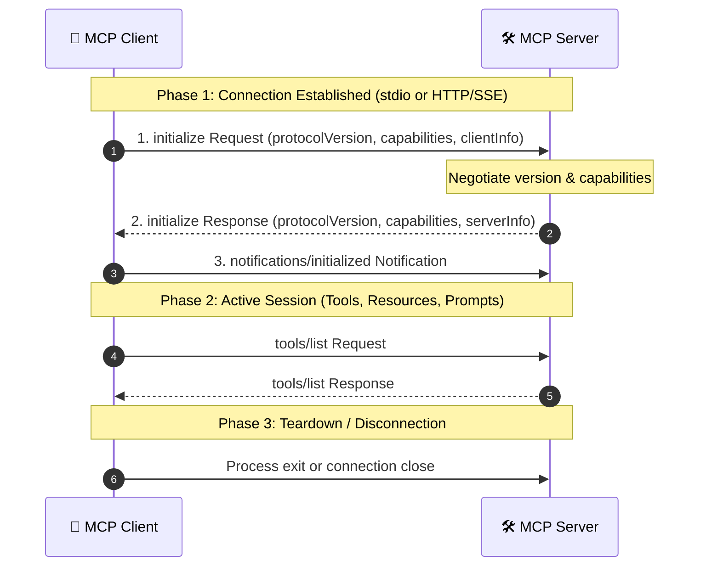
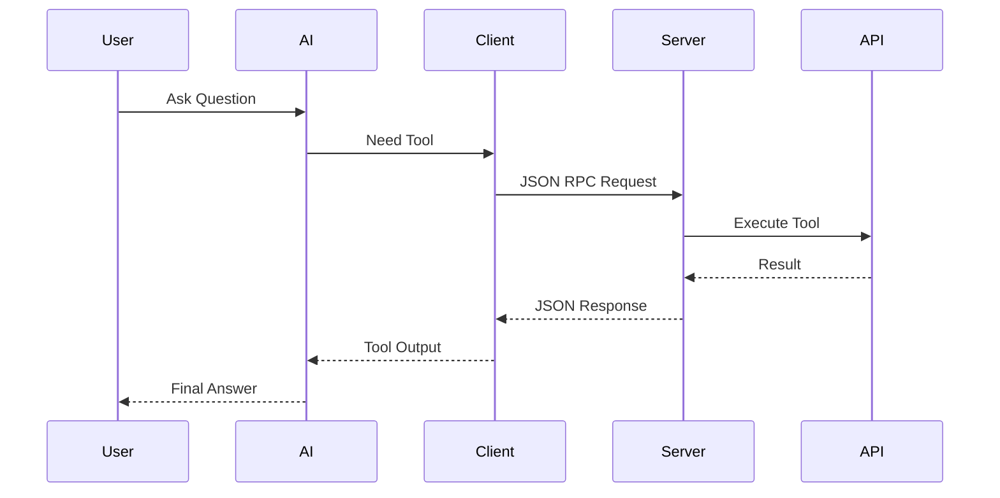
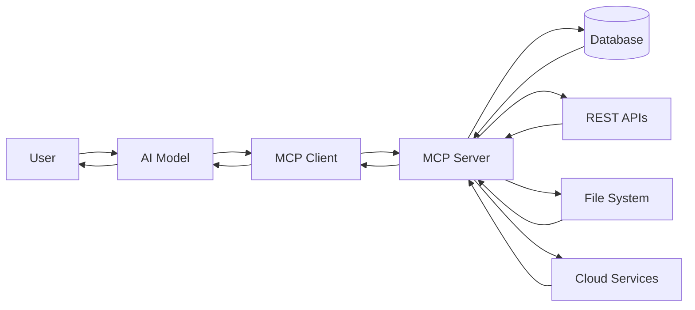

# Module 02 - MCP Architecture

> Learn how the Model Context Protocol (MCP) works internally and understand how AI models communicate with tools, databases, APIs, and external applications.

---

# Table of Contents

- What is MCP Architecture?
- High-Level Architecture
- Components of MCP
- User Flow
- Client
- Server
- Transport Layer
- Communication Flow
- Request Lifecycle
- Types of MCP Servers
- Stateless vs Stateful Communication
- Security
- Architecture Diagram
- Sequence Diagram
- Real World Example
- Advantages
- Summary

---

# What is MCP Architecture?

The **Model Context Protocol (MCP)** architecture defines how an AI model communicates with external tools and applications.

Instead of giving AI direct access to APIs, databases, or operating systems, MCP introduces a standardized architecture that acts as a bridge between the AI model and external resources.

Think of MCP as:

> **USB-C for AI**

Just as USB-C allows different devices to communicate using one standard, MCP allows AI models to communicate with any tool using one protocol.

---

# High-Level Architecture


---

# Mermaid Architecture Diagram



---

# User Request Flow

Suppose the user asks:

> "What is my account balance?"

The flow is:

```
User

↓

AI Model

↓

MCP Client

↓

MCP Server

↓

Bank Database

↓

MCP Server

↓

MCP Client

↓

AI Model

↓

User receives answer
```

---

# Request Flow Diagram



---

# Main Components of MCP

MCP architecture consists of four major components.

1. User/Host
2. MCP Client
3. MCP Server
4. External Resources

Let's understand each one.

---

# 1. User

The user interacts with the AI using natural language.

Example:

```
Find today's weather.
```

or

```
Create a GitHub repository.
```

The user never communicates directly with the MCP server.

Instead:

```
User
↓

AI Model
↓

MCP Client
```

---

# 2. AI Model

The AI model understands the user's intent.

Example:

User:

```
Show me my calendar.
```

The AI understands:

```
Intent:
Retrieve calendar events
```

But the AI itself does not access Google Calendar.

Instead it asks the MCP Client.

---

# 3. MCP Client

The MCP Client is the bridge between the AI model and the MCP server.

It performs several important tasks.

Responsibilities:

- Sends requests
- Receives responses
- Starts servers
- Maintains connection
- Discovers tools
- Calls tools
- Handles errors
- Converts responses

Example:

```
AI:
Need weather information

↓

Client

↓

Calls Weather Server
```

---

## Client Responsibilities

```
User Request

↓

Understand Tool Needed

↓

Connect to MCP Server

↓

Send JSON-RPC Request

↓

Receive Response

↓

Return to AI
```

---

# MCP Client Diagram



---

# 4. MCP Server

The MCP Server exposes capabilities.

It tells the AI:

- What tools exist
- What resources exist
- What prompts exist

The server contains business logic.

Example:

Weather Server

```
Tool:

get_weather(city)
```

GitHub Server

```
Tool:

create_repository(name)
```

Database Server

```
Tool:

fetch_user(id)
```

---

## Server Responsibilities

- Register tools
- Register prompts
- Register resources
- Execute logic
- Connect databases
- Call APIs
- Return structured responses

---

# MCP Server Diagram



---

# Transport Layer

The transport layer carries communication between the client and server.

Think of it as a communication channel.

Without transport:

```
Client ❌ Server
```

With transport:

```
Client ===== Transport ===== Server
```

---

# Supported Transports

MCP currently supports multiple transports.

Common ones include:

- STDIO
- HTTP
- WebSocket
- Streamable HTTP

---

## STDIO

```
Client

↓

stdin

↓

Server

↓

stdout

↓

Client
```

Used when:

- Running locally
- Desktop apps
- Claude Desktop
- Cursor

Advantages:

- Fast
- Easy
- Secure

---

## HTTP

```
Client

↓

HTTP Request

↓

Server

↓

HTTP Response
```

Used for:

- Cloud services
- Remote servers
- APIs

---

## WebSocket & Legacy Transports

Provides persistent bidirectional communication over sockets:

```
Client ⇄ Server
```

> [!NOTE]
> **Specification Note:** The official Model Context Protocol specification primarily standardizes **stdio** (for local sub-processes) and **Streamable HTTP / SSE** (for remote network services). WebSockets and raw TCP sockets are considered legacy or custom adapter transports. When designing for universal client interoperability, prefer `stdio` or `HTTP with SSE`.

---

### Transport Performance & Latency Modeling

When selecting a transport for an MCP deployment, the overall round-trip time (RTT) for a tool or resource invocation is modeled by:

$$
T_{\text{total}} = T_{\text{serialize}} + T_{\text{transport}} + T_{\text{queue}} + T_{\text{exec}} + T_{\text{deserialize}}
$$

where:
- $T_{\text{total}}$ is the total wall-clock duration from client request dispatch to result receipt.
- $T_{\text{serialize}}$ is the client-side time required to encode the JSON-RPC payload.
- $T_{\text{transport}}$ is the physical message transit latency across the transport channel.
- $T_{\text{queue}}$ is the buffering/queue wait time inside the server event loop.
- $T_{\text{exec}}$ is the actual execution time of the target tool, resource read, or prompt generation.
- $T_{\text{deserialize}}$ is the client-side JSON parsing and schema validation time.

For local **stdio** connections, the transport latency is negligible ($T_{\text{transport, stdio}} \approx 0 \text{ ms}$) as it operates via kernel OS pipes. For remote network transports (HTTP / SSE / WebSocket), $T_{\text{transport}}$ is governed by:

$$
T_{\text{transport, net}} = \text{RTT}_{\text{network}} + \frac{S}{B}
$$

where:
- $\text{RTT}_{\text{network}}$ is the network round-trip ping between client host and server.
- $S$ is the payload data size in bytes.
- $B$ is the effective transport bandwidth in bytes per second.

### JSON-RPC Request Reliability

Protocol invocation success rate $R$ across $n$ consecutive MCP requests is measured as:

$$
R = \frac{1}{n} \sum_{i=1}^{n} \mathbb{I}(e_i = \text{null})
$$

where:
- $n$ is the total number of JSON-RPC requests issued.
- $e_i$ is the error object returned in the $i$-th response.
- $\mathbb{I}(\cdot)$ is the indicator function, evaluating to $1$ if the request completed without a JSON-RPC error, and $0$ otherwise.

---

# Communication Protocol & Lifecycle

The Model Context Protocol is built on **JSON-RPC 2.0**, using stateful bidirectional connections across either standard input/output (`stdio`) or Streamable HTTP with Server-Sent Events (`HTTP + SSE`).

## 1. Protocol Lifecycle & Initialization Handshake

Before any tools, resources, or prompts can be used, the client and server must perform a strict **3-step initialization handshake**:



### Step 1: `initialize` Request (Client ➔ Server)
The client announces its supported protocol version and client capabilities:

```json
{
  "jsonrpc": "2.0",
  "id": 1,
  "method": "initialize",
  "params": {
    "protocolVersion": "2024-11-05",
    "capabilities": {
      "roots": { "listChanged": true },
      "sampling": {}
    },
    "clientInfo": {
      "name": "claude-desktop",
      "version": "1.0.0"
    }
  }
}
```

### Step 2: `initialize` Result (Server ➔ Client)
The server confirms the negotiated version, server info, and server-side capabilities:

```json
{
  "jsonrpc": "2.0",
  "id": 1,
  "result": {
    "protocolVersion": "2024-11-05",
    "capabilities": {
      "tools": { "listChanged": true },
      "resources": { "subscribe": true, "listChanged": true },
      "prompts": { "listChanged": true },
      "logging": {}
    },
    "serverInfo": {
      "name": "enterprise-mcp-server",
      "version": "2.1.0"
    }
  }
}
```

### Step 3: `notifications/initialized` (Client ➔ Server)
The client sends a notification confirming initialization. **The server MUST NOT process any other requests before this notification is received.**

```json
{
  "jsonrpc": "2.0",
  "method": "notifications/initialized"
}
```

### Version Negotiation Rules
1. The client proposes the latest specification version it supports (e.g., `"2024-11-05"`).
2. If the server supports that version, it responds with the same version string.
3. If the server does not support the client's proposed version, it may return another version it supports that the client can adapt to, or return an error rejecting the connection.

---

## 2. Capability Negotiation Matrix

MCP uses explicit capability negotiation so clients and servers know which features are supported:

| Capability | Declared By | Purpose | Sub-options |
|---|---|---|---|
| `tools` | Server | Exposes callable actions | `listChanged: boolean` |
| `resources` | Server | Exposes passive context data | `subscribe: boolean`, `listChanged: boolean` |
| `prompts` | Server | Exposes prompt templates | `listChanged: boolean` |
| `logging` | Server | Emits diagnostic events | `{}` |
| `sampling` | Client | Allows server to request LLM completions | `{}` |
| `roots` | Client | Exposes accessible workspace boundaries | `listChanged: boolean` |

---

## 3. JSON-RPC Message Types & Error Envelopes

MCP defines four message types:
1. **Request:** Contains `"id"`, `"method"`, and optional `"params"`. Requires a response.
2. **Response (Success):** Contains matching `"id"` and `"result"`.
3. **Response (Error):** Contains matching `"id"` and `"error"` (`code`, `message`, optional `data`).
4. **Notification:** Contains `"method"` and `"params"` without an `"id"`. No response is permitted.

### Protocol Errors vs. Tool Execution Errors

A critical architectural distinction in MCP:
- **Protocol-Level Errors** (`error` object in JSON-RPC envelope) indicate protocol violations, invalid JSON, or unregistered methods.
- **Tool-Level Failures** (e.g. division by zero, database not found) MUST return a successful JSON-RPC response with `isError: true` inside the `content` result so the LLM can observe and recover from the error.

```json
/* Protocol Error (Bad schema / missing method) */
{
  "jsonrpc": "2.0",
  "id": 12,
  "error": {
    "code": -32601,
    "message": "Method not found: tools/unknown_tool"
  }
}
```

```json
/* Application Tool Failure (Clean recovery for LLM) */
{
  "jsonrpc": "2.0",
  "id": 13,
  "result": {
    "content": [
      {
        "type": "text",
        "text": "Error: Division by zero is undefined."
      }
    ],
    "isError": true
  }
}
```

---

# Communication Flow



---

# Request Lifecycle

```
User asks question

↓

AI understands request

↓

Client selects server

↓

Server executes tool

↓

Tool accesses API

↓

Result returned

↓

AI generates response

↓

User receives answer
```

---

# Tool Discovery

Before calling tools, the client asks:

```
What tools are available?
```

Server replies:

```
Search

Weather

Calculator

GitHub

Database
```

The AI then decides which tool to use.

---

# Resources

Resources are read-only information.

Examples:

- PDF
- Markdown
- CSV
- Logs
- Database Records

Example:

```
read://company_handbook.md
```

---

# Prompts

Servers can also provide reusable prompts.

Example:

```
Summarize Meeting

Explain Code

Review PR

Translate Text
```

The AI can reuse these prompts.

---

# External Resources

The MCP Server can communicate with many external systems.

Examples:

```
Database

REST API

Filesystem

Cloud Storage

GitHub

Slack

Google Drive

Notion

Jira

Docker

Kubernetes
```

---

# Types of MCP Servers

### Database Server

Connects AI with databases.

Examples:

- PostgreSQL
- MySQL
- SQLite
- MongoDB

---

### File Server

Reads and writes files.

Examples:

- Markdown
- Images
- PDFs
- CSV

---

### API Server

Communicates with REST APIs.

Examples:

- Weather API
- GitHub API
- Stripe API
- OpenAI API

---

### Local Tool Server

Runs local applications.

Examples:

- Terminal
- VS Code
- Docker
- Git

---

# Stateless vs Stateful Communication

## Stateless

Each request is independent.

```
Request 1

↓

Done

Request 2

↓

Done
```

---

## Stateful

The server remembers previous interactions.

Useful for:

- Chat sessions
- Authentication
- Long-running workflows

---

# Security

MCP servers should follow security best practices.

Examples:

- Authentication
- Authorization
- Permission checks
- Input validation
- Encrypted communication
- Secret management
- Rate limiting
- Logging

Never expose:

- API Keys
- Passwords
- Database credentials

---

# Advantages of MCP Architecture

✅ Standard communication

✅ Reusable tools

✅ Easy integration

✅ AI model independent

✅ Modular design

✅ Secure architecture

✅ Easy maintenance

✅ Scalable

✅ Extensible

---

# Real World Example

Imagine asking:

> "Create a GitHub repository named MCP-Learning."

Flow:

```
User

↓

AI Model

↓

MCP Client

↓

GitHub MCP Server

↓

GitHub API

↓

Repository Created

↓

Server

↓

Client

↓

AI

↓

User
```

---

# Complete Architecture Overview



---

# Module Summary

In this module, you learned:

- What MCP Architecture is
- How the User interacts with AI
- Role of the MCP Client
- Role of the MCP Server
- Transport Layer
- JSON-RPC Communication
- Request Lifecycle
- Tool Discovery
- Resources and Prompts
- External Integrations
- Security Best Practices
- Complete End-to-End Architecture

---

# What's Next?

➡️ **[Module 03 — MCP Components](../Module%2003%20-%20MCP%20Components/README.md)**

In the next module, you will explore:

- Tools
- Resources
- Prompts
- Sampling
- Roots & Capabilities
- Logging & Diagnostics
- Initialization Lifecycle

---

## 🧭 Navigation

- ⬅️ **Previous Module:** [Module 01 — Introduction](../Module%2001%20Introduction/00%20Overview.md)
- 🏠 **Main Index:** [Table of Contents](../INDEX.md) | [Root README](../README.md)
- ➡️ **Next Module:** [Module 03 — MCP Components](../Module%2003%20-%20MCP%20Components/README.md)