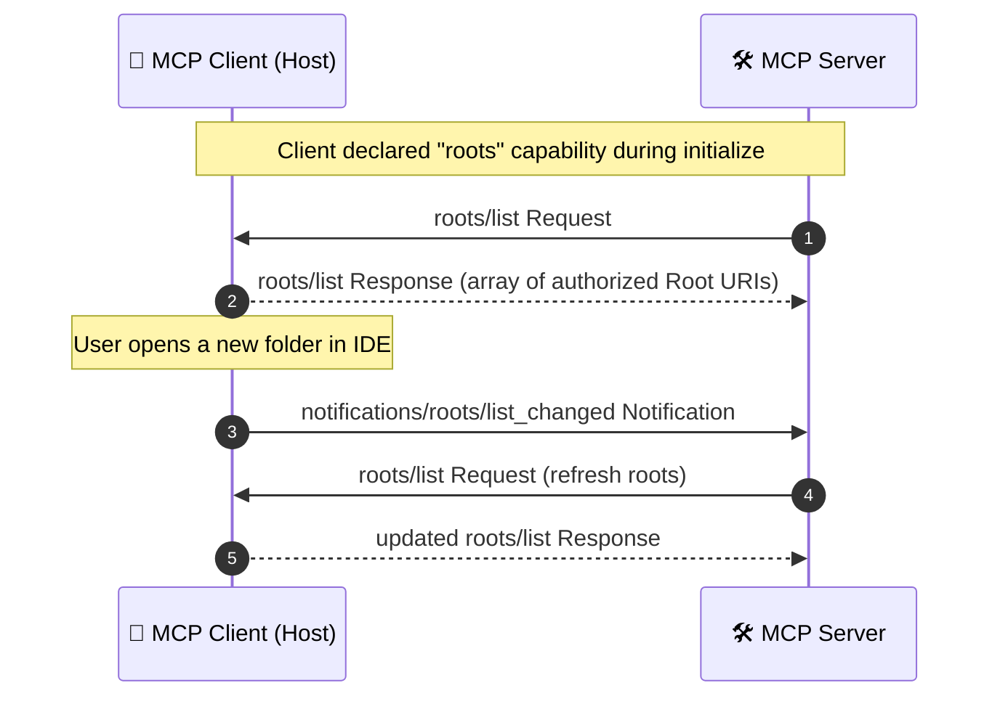
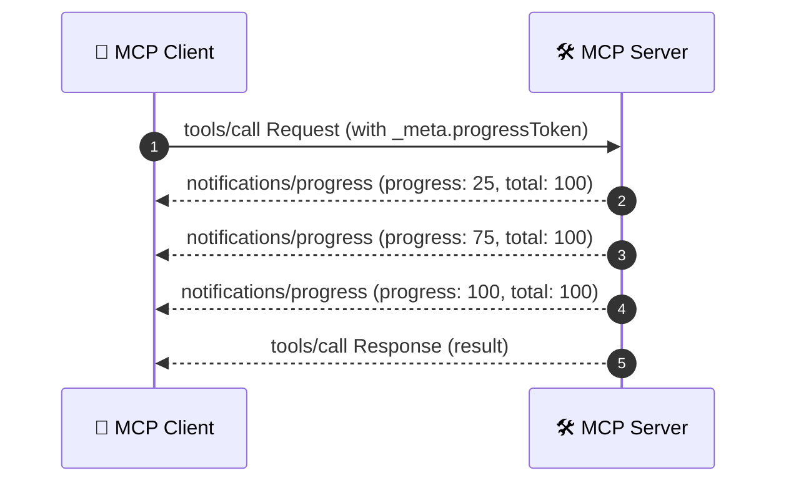

# Roots & Advanced Protocol Capabilities

> A complete guide to advanced Model Context Protocol capabilities: **Roots**, **Progress Notifications**, **Cancellation**, **Argument Completions (Elicitation)**, and **Ping/Keepalive**.

---

## 📌 Overview

Beyond the three primary primitives (Tools, Resources, Prompts) and Server Sampling / Logging, the Model Context Protocol defines crucial utility and control capabilities:

1. **Roots:** Allows the client to inform the server which directories, repositories, or workspaces are in scope.
2. **Progress Notifications:** Enables servers to stream progress updates for long-running tool executions.
3. **Cancellation:** Allows clients to abort in-flight requests when a user cancels or navigates away.
4. **Completions (Elicitation):** Provides interactive autocomplete suggestions for prompt arguments and resource templates.
5. **Ping:** Verifies liveness and connection health between client and server.

---

## 1. Roots (`roots/list` and `notifications/roots/list_changed`)

### What are Roots?
In desktop IDEs (Cursor, VS Code) and AI hosts (Claude Desktop), a user may have multiple projects or folders open. **Roots** allow the client to declare these filesystem boundaries to the MCP server.

This prevents servers from operating indiscriminately across the entire disk.



### JSON-RPC Message Trace

#### Request: Server requests roots
```json
{
  "jsonrpc": "2.0",
  "id": 10,
  "method": "roots/list"
}
```

#### Response: Client returns declared workspace roots
```json
{
  "jsonrpc": "2.0",
  "id": 10,
  "result": {
    "roots": [
      {
        "uri": "file:///Users/developer/projects/web-app",
        "name": "Frontend Workspace"
      },
      {
        "uri": "file:///Users/developer/projects/api-service",
        "name": "Backend Service"
      }
    ]
  }
}
```

#### Notification: Workspace changed
```json
{
  "jsonrpc": "2.0",
  "method": "notifications/roots/list_changed"
}
```

> [!SECURITY]
> Servers exposing filesystem tools or resources MUST validate that requested paths reside strictly within one of the declared root URIs.

---

## 2. Progress Notifications (`notifications/progress`)

### Why Progress is Needed
Certain tools perform long-running tasks:
- Indexing a repository with 50,000 files
- Downloading and parsing a large database dump
- Running an extensive automated test suite

Without progress updates, the client has no way to tell if the server is still working or frozen.

### Message Flow



#### 1. Client supplies a `progressToken` in request metadata:
```json
{
  "jsonrpc": "2.0",
  "id": 42,
  "method": "tools/call",
  "params": {
    "name": "index_repository",
    "arguments": {
      "path": "/workspace"
    },
    "_meta": {
      "progressToken": "token-xyz-123"
    }
  }
}
```

#### 2. Server emits progress notifications:
```json
{
  "jsonrpc": "2.0",
  "method": "notifications/progress",
  "params": {
    "progressToken": "token-xyz-123",
    "progress": 35,
    "total": 100
  }
}
```

---

## 3. Cancellation (`notifications/cancelled`)

When a user clicks "Stop" or navigates to another page, the client should inform the server to immediately abort execution and release resources.

### Cancellation Message Envelope

```json
{
  "jsonrpc": "2.0",
  "method": "notifications/cancelled",
  "params": {
    "requestId": 42,
    "reason": "User aborted the generation request"
  }
}
```

### SDK Handling

- **TypeScript SDK:** Integrated with the standard Web `AbortSignal`. Handlers receive `{ signal: AbortSignal }` and pass it to `fetch` or database queries:
  ```typescript
  server.tool("search", { query: z.string() }, async ({ query }, { signal }) => {
    const res = await fetch(`https://api.example.com?q=${query}`, { signal });
    return { content: [{ type: "text", text: await res.text() }] };
  });
  ```
- **Python SDK:** Cancelled asyncio tasks raise `asyncio.CancelledError`, allowing `try...finally` cleanup blocks to run.

---

## 4. Completions & Argument Elicitation (`completion/complete`)

The `completion/complete` capability allows an MCP server to provide interactive auto-completion options to the client UI for prompt arguments or resource templates.

### Example: Auto-completing Database Table Names

#### Request from Client:
```json
{
  "jsonrpc": "2.0",
  "id": 88,
  "method": "completion/complete",
  "params": {
    "ref": {
      "type": "ref/prompt",
      "name": "generate_sql_query"
    },
    "argument": {
      "name": "table",
      "value": "user"
    }
  }
}
```

#### Response from Server:
```json
{
  "jsonrpc": "2.0",
  "id": 88,
  "result": {
    "completion": {
      "values": [
        "users",
        "user_profiles",
        "user_sessions",
        "user_audit_logs"
      ],
      "total": 4,
      "hasMore": false
    }
  }
}
```

---

## 5. Liveness & Keep-Alive (`ping`)

Either client or server may issue a `ping` request to verify that the transport is alive and responsive:

```json
{
  "jsonrpc": "2.0",
  "id": 99,
  "method": "ping"
}
```

Response:
```json
{
  "jsonrpc": "2.0",
  "id": 99,
  "result": {}
}
```

If the counterpart fails to respond within a timeout threshold (e.g., 5 seconds), the client or supervisor can restart the process.

---

## 📋 Capabilities Summary Matrix

| Capability | Direction | Method / Notification | Purpose |
|---|---|---|---|
| **Roots** | Server ➔ Client | `roots/list`, `notifications/roots/list_changed` | Boundary discovery & workspace scoping |
| **Progress** | Server ➔ Client | `notifications/progress` | Long-running task step reporting |
| **Cancellation** | Client ➔ Server | `notifications/cancelled` | Aborting in-flight requests |
| **Completion** | Client ➔ Server | `completion/complete` | Interactive argument elicitation & autocomplete |
| **Ping** | Bidirectional | `ping` | Connection heartbeat and liveness checks |

---

## 🧭 Navigation

- ⬅️ **Previous Chapter:** [05 Logging](../05-Logging/01_MCP%20Logging%20-%20Theory.md)
- 🏠 **Module 03 Hub:** [Module 03 README](../README.md)
- ➡️ **Next Module:** [Module 04 - Installation](../../Module%2004%20-%20Installation/Installation.md)
