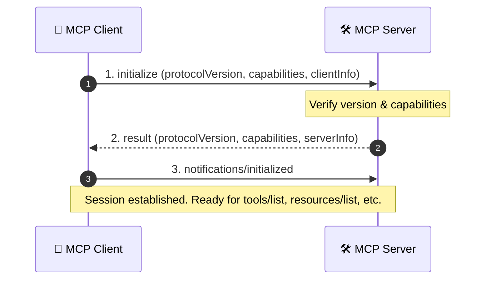

# MCP Client — Theory

## 1. Introduction

The **MCP Client** is one of the most important components in the Model Context Protocol (MCP) architecture.

It is responsible for establishing communication between an **MCP Host** and an **MCP Server**.

The client allows the host application to:

* Connect to an MCP Server
* Initialize an MCP session
* Discover available capabilities
* Discover available tools
* Execute tools
* Receive tool results
* Handle communication with the server

The basic relationship is:

```text
USER
  │
  ▼
MCP HOST
  │
  ▼
MCP CLIENT
  │
  ▼
MCP SERVER
  │
  ▼
TOOLS / RESOURCES / PROMPTS
```

The MCP Client acts as the communication layer between the host and the server.

---

# 2. What is an MCP Client?

An **MCP Client** is a component that communicates with an MCP Server using the Model Context Protocol.

It is normally managed by an MCP Host.

The client is responsible for sending requests to the server and receiving responses.

```text
┌──────────────────┐
│     MCP HOST     │
│                  │
│   Application    │
│       + LLM      │
└────────┬─────────┘
         │
         ▼
┌──────────────────┐
│    MCP CLIENT    │
│                  │
│ Connect          │
│ Discover         │
│ Execute          │
│ Receive          │
└────────┬─────────┘
         │
         │ MCP Protocol
         ▼
┌──────────────────┐
│    MCP SERVER    │
│                  │
│ Tools            │
│ Resources        │
│ Prompts          │
└──────────────────┘
```

The client does not normally implement the actual business functionality of a tool.

Instead, it communicates with a server that provides those capabilities.

---

# 3. Why Do We Need an MCP Client?

Modern AI applications often need access to external systems.

For example:

* Databases
* GitHub
* File systems
* APIs
* Search engines
* Cloud services
* Business applications
* Internal company systems

Without MCP, an AI application may need custom integrations for every external service.

```text
AI Application
     │
     ├── Custom GitHub Integration
     │
     ├── Custom Database Integration
     │
     ├── Custom File Integration
     │
     └── Custom API Integration
```

This can become difficult to maintain.

MCP provides a standardized protocol.

```text
                     AI HOST
                        │
                        ▼
                   MCP CLIENT
                        │
              Standard MCP Protocol
                        │
          ┌─────────────┼─────────────┐
          ▼             ▼             ▼
     MCP Server A   MCP Server B   MCP Server C
          │             │             │
       GitHub        Database       Files
```

The MCP Client provides a standardized communication mechanism.

---

# 4. MCP Host vs MCP Client vs MCP Server

These three concepts are important and should not be confused.

## MCP Host

The **MCP Host** is the application that interacts with the user and usually contains or manages the LLM.

Examples of host responsibilities:

* User interface
* LLM interaction
* Conversation management
* MCP Client management
* Context management
* Presenting results to the user

---

## MCP Client

The **MCP Client** is responsible for communication with an MCP Server.

Responsibilities include:

* Establishing a connection
* Initializing a session
* Discovering capabilities
* Listing tools
* Calling tools
* Receiving results
* Managing protocol communication

---

## MCP Server

The **MCP Server** exposes capabilities to MCP Clients.

These capabilities may include:

* Tools
* Resources
* Prompts

The server handles requests and executes the requested functionality.

---

## Comparison

| Component  | Main Responsibility           |
| ---------- | ----------------------------- |
| MCP Host   | Runs the AI application       |
| MCP Client | Communicates with MCP Server  |
| MCP Server | Provides capabilities         |
| Tool       | Performs a specific operation |

---

# 5. Simple MCP Client Architecture

The basic architecture can be represented as:

```text
                         USER
                           │
                           │ Request
                           ▼
                    ┌─────────────┐
                    │  MCP HOST   │
                    │             │
                    │     LLM     │
                    └──────┬──────┘
                           │
                           ▼
                    ┌─────────────┐
                    │ MCP CLIENT  │
                    └──────┬──────┘
                           │
                     MCP Protocol
                           │
                           ▼
                    ┌─────────────┐
                    │ MCP SERVER  │
                    └──────┬──────┘
                           │
             ┌─────────────┼─────────────┐
             ▼             ▼             ▼
          Tool A        Tool B        Tool C
```

The client is positioned between the host and server.

---

# 6. Core Responsibilities of an MCP Client

An MCP Client performs several operations.

For this module, the most important four are:

```text
1. CONNECT
      ↓
2. DISCOVER TOOLS
      ↓
3. EXECUTE TOOLS
      ↓
4. RECEIVE RESPONSE
```

These four stages form the core learning model for understanding MCP Client behavior.

---

# 7. Connect

The first major responsibility of the client is to establish communication with an MCP Server.

The client needs a communication channel through which MCP messages can be exchanged.

Conceptually:

```text
MCP Client
     │
     │ Connection / Initialization
     ▼
MCP Server
     │
     │ Initialization Response
     ▼
MCP Client
```

After successful initialization, the client can communicate with the server.

---

# 8. Client Initialization & Capability Negotiation

Before normal operations begin, the client and server establish an MCP session using a strict 3-step initialization handshake defined by the MCP specification.



### Step 1: `initialize` Request
The client starts by declaring the protocol version it wants to speak and what client-side capabilities it supports (such as `roots` or `sampling`):

```json
{
  "jsonrpc": "2.0",
  "id": 1,
  "method": "initialize",
  "params": {
    "protocolVersion": "2024-11-05",
    "capabilities": {
      "roots": {
        "listChanged": true
      },
      "sampling": {}
    },
    "clientInfo": {
      "name": "my-mcp-client",
      "version": "1.0.0"
    }
  }
}
```

### Step 2: `initialize` Response
The server responds with its negotiated protocol version, supported server capabilities (such as `tools`, `resources`, `prompts`, and `logging`), and server metadata:

```json
{
  "jsonrpc": "2.0",
  "id": 1,
  "result": {
    "protocolVersion": "2024-11-05",
    "capabilities": {
      "tools": {
        "listChanged": true
      },
      "resources": {
        "subscribe": true,
        "listChanged": true
      },
      "prompts": {
        "listChanged": true
      },
      "logging": {}
    },
    "serverInfo": {
      "name": "enterprise-data-server",
      "version": "1.2.0"
    }
  }
}
```

### Step 3: `notifications/initialized`
The client sends a final confirmation notification. **The server MUST NOT process any other requests before this notification is received:**

```json
{
  "jsonrpc": "2.0",
  "method": "notifications/initialized"
}
```

### Version Negotiation Rules
- The client provides its supported `protocolVersion` (e.g., `"2024-11-05"`).
- The server responds with the version it will use. If the versions match, initialization succeeds.
- If the server does not support the requested version, it may offer the closest compatible version or return a protocol error.

---

# 9. Discover Tools

After establishing communication, the client can discover what tools are available on the server.

Conceptually, the client requests the server's available tools.

```text
MCP Client
     │
     │ tools/list
     ▼
MCP Server
     │
     │ Tool Definitions
     ▼
MCP Client
```

The server can return information about its available tools.

For example:

```text
Available Tools

├── calculator
├── search_products
├── get_weather
└── database_query
```

---

# 10. Tool Definition

A tool definition describes what a tool does and what input it expects.

A conceptual tool definition may look like:

```json
{
  "name": "search_products",
  "description": "Search products",
  "inputSchema": {
    "type": "object",
    "properties": {
      "query": {
        "type": "string"
      }
    }
  }
}
```

The client can provide this information to the host or model so that the application knows what tools are available.

---

# 11. Why Tool Discovery Is Important

Tool discovery makes MCP dynamic.

The host does not necessarily need to hard-code every available tool.

Instead:

```text
Client
   │
   │ Discover
   ▼
Server
   │
   │ Available Tools
   ▼
Client
   │
   ▼
Host / LLM
```

The application can learn what capabilities a server provides.

This makes MCP servers more reusable.

---

# 12. Execute Tools

Once the model or host determines that a tool is required, the MCP Client can request the server to execute that tool.

Conceptually:

```text
MCP Client
     │
     │ Tool Call
     ▼
MCP Server
     │
     ▼
   Tool
     │
     ▼
External System
```

A conceptual tool request may look like:

```json
{
  "name": "search_products",
  "arguments": {
    "query": "laptop"
  }
}
```

The server receives the request and executes the corresponding tool.

---

# 13. Tool Execution Flow

The complete tool execution process can be represented as:

```text
USER
 │
 │ "Find laptops"
 ▼
MCP HOST
 │
 ▼
LLM
 │
 │ Select required tool
 ▼
MCP CLIENT
 │
 │ Tool Call
 ▼
MCP SERVER
 │
 ▼
TOOL
 │
 ▼
EXTERNAL SERVICE
 │
 ▼
TOOL RESULT
 │
 ▼
MCP SERVER
 │
 ▼
MCP CLIENT
```

The client is responsible for carrying the request to the server and receiving the result.

---

# 14. Receive Response

After the server executes the requested tool, it returns the result to the client.

```text
MCP Server
     │
     │ Tool Result
     ▼
MCP Client
     │
     ▼
MCP Host
     │
     ▼
LLM
     │
     ▼
User
```

The response may contain:

* Text
* Structured data
* Content blocks
* Error information
* Other protocol-supported result information

---

# 15. Complete Client Lifecycle

The basic MCP Client lifecycle can be represented as:

```text
┌──────────────┐
│    START     │
└──────┬───────┘
       │
       ▼
┌──────────────┐
│    CONNECT   │
└──────┬───────┘
       │
       ▼
┌──────────────┐
│ INITIALIZE   │
└──────┬───────┘
       │
       ▼
┌──────────────┐
│    READY     │
└──────┬───────┘
       │
       ▼
┌──────────────┐
│   DISCOVER   │
│    TOOLS     │
└──────┬───────┘
       │
       ▼
┌──────────────┐
│ TOOL SELECTED│
└──────┬───────┘
       │
       ▼
┌──────────────┐
│ EXECUTE TOOL │
└──────┬───────┘
       │
       ▼
┌──────────────┐
│    RECEIVE   │
│    RESULT    │
└──────┬───────┘
       │
       ▼
┌──────────────┐
│    READY     │
└──────────────┘
```

---

# 16. Four Core Client Operations

For this repository, remember the client using this simple model:

```text
                 MCP CLIENT
                     │
       ┌─────────────┼─────────────┐
       │             │             │
       ▼             ▼             ▼
   CONNECT       DISCOVER       EXECUTE
                    TOOLS         TOOLS
                       │             │
                       └──────┬──────┘
                              ▼
                         RECEIVE
                         RESPONSE
```

Or simply:

```text
CONNECT
   ↓
DISCOVER
   ↓
EXECUTE
   ↓
RECEIVE
```

---

# 17. Example — Calculator Tool

Suppose an MCP Server provides a calculator tool.

```text
calculator
```

The user asks:

> What is 25 × 10?

The process becomes:

```text
USER
 │
 │ What is 25 × 10?
 ▼
MCP HOST
 │
 ▼
LLM
 │
 │ Calculator required
 ▼
MCP CLIENT
 │
 │ Call calculator
 ▼
MCP SERVER
 │
 ▼
CALCULATOR TOOL
 │
 │ 25 × 10
 ▼
250
 │
 ▼
MCP SERVER
 │
 ▼
MCP CLIENT
 │
 ▼
MCP HOST
 │
 ▼
LLM
 │
 ▼
USER
```

The user sees:

```text
250
```

---

# 18. Example — Weather Tool

Consider a weather MCP Server.

The server exposes:

```text
get_weather
```

The user asks:

> What is the weather in Pune?

The flow becomes:

```text
User
 │
 ▼
Host
 │
 ▼
LLM
 │
 │ Weather information required
 ▼
MCP Client
 │
 │ Call get_weather
 ▼
MCP Server
 │
 ▼
Weather Tool
 │
 ▼
Weather API
 │
 ▼
Weather Data
 │
 ▼
MCP Server
 │
 ▼
MCP Client
 │
 ▼
Host
 │
 ▼
LLM
 │
 ▼
User
```

---

# 19. MCP Client and Multiple Servers

An MCP Host can work with multiple MCP Servers.

Conceptually:

```text
                         MCP HOST
                             │
              ┌──────────────┼──────────────┐
              │              │              │
              ▼              ▼              ▼
         MCP CLIENT      MCP CLIENT      MCP CLIENT
              │              │              │
              ▼              ▼              ▼
         MCP SERVER A    MCP SERVER B    MCP SERVER C
              │              │              │
           GitHub         Database         Files
```

For example:

```text
Client 1 → GitHub Server
Client 2 → Database Server
Client 3 → File Server
```

Each client maintains communication with its corresponding server.

---

# 20. Client and Tools

The relationship between the client and tools can be understood as:

```text
MCP Client
     │
     │ Discover
     ▼
MCP Server
     │
     ├── Tool A
     ├── Tool B
     ├── Tool C
     └── Tool D
```

The client does not need to know the internal implementation of the tools.

It only needs to communicate using the MCP protocol.

This creates a separation between:

```text
Communication
      │
      ▼
MCP Client
      │
      ▼
MCP Server
      │
      ▼
Business Logic
```

---

# 21. Client as a Communication Layer

One of the easiest ways to understand the MCP Client is to think of it as a communication layer.

```text
┌─────────────────────────┐
│       MCP HOST          │
│                         │
│ Application + LLM       │
└────────────┬────────────┘
             │
             ▼
┌─────────────────────────┐
│       MCP CLIENT        │
│                         │
│ Communication Layer     │
└────────────┬────────────┘
             │
             │ MCP Protocol
             ▼
┌─────────────────────────┐
│       MCP SERVER        │
│                         │
│ Capability Provider     │
└─────────────────────────┘
```

The client separates the application from the server implementation.

---

# 22. Client Does Not Equal Host

A common beginner mistake is treating the MCP Host and MCP Client as the same concept.

They are related but have different responsibilities.

```text
MCP HOST
 │
 │ Manages
 ▼
MCP CLIENT
 │
 │ Communicates with
 ▼
MCP SERVER
```

The host is the application environment.

The client is the protocol communication component.

The server provides capabilities.

---

# 23. Client Does Not Equal Server

The client and server also have different roles.

```text
CLIENT                         SERVER
  │                              │
  │────── Request ──────────────►│
  │                              │
  │                              │ Execute
  │                              │ Tool
  │                              │
  │◄────── Response ─────────────│
  │                              │
```

The client requests.

The server provides.

---

# 24. Error Handling

An MCP Client must also handle failures.

Possible problems include:

* Connection failure
* Initialization failure
* Invalid tool request
* Invalid arguments
* Tool execution failure
* Server error
* Timeout
* Unexpected response

Conceptually:

```text
MCP Client
     │
     │ Tool Call
     ▼
MCP Server
     │
     ▼
Tool
     │
     │ Error
     ▼
MCP Server
     │
     │ Error Response
     ▼
MCP Client
     │
     ▼
MCP Host
```

A robust client should handle errors instead of assuming every request succeeds.

### Protocol Error Codes vs. Tool Errors

In the Model Context Protocol, errors fall into two distinct categories:

1. **JSON-RPC Protocol Errors**: Sent in the top-level `error` object when protocol negotiation, parsing, or transport fails.
   - `-32700`: Parse error (invalid JSON received by the server).
   - `-32600`: Invalid Request (payload does not conform to JSON-RPC 2.0).
   - `-32601`: Method not found (e.g., calling an unrecognized method).
   - `-32602`: Invalid params (tool arguments do not match JSON Schema).
   - `-32603`: Internal error (server crashed during message processing).

2. **Application Tool Errors**: The JSON-RPC call itself succeeds (`result` object returned), but `isError: true` is set inside the content block, allowing the LLM to inspect the failure message and self-correct:
   ```json
   {
     "jsonrpc": "2.0",
     "id": 1,
     "result": {
       "isError": true,
       "content": [
         {
           "type": "text",
           "text": "Error: File '/etc/hosts' not found or access denied."
         }
       ]
     }
   }
   ```

### Mathematical Formulation of Exponential Backoff with Full Jitter

When an MCP client experiences transport disconnects or transient server timeouts, reconnection attempts must implement randomized exponential backoff. The backoff delay $t_{\text{wait}}(i)$ for attempt $i$ is calculated as:

$$
t_{\text{wait}}(i) = \min\left(t_{\text{max}}, t_{\text{base}} \cdot 2^i\right) \cdot \xi
$$

where:
- $i \in \{0, 1, 2, \dots\}$ represents the retry attempt index.
- $t_{\text{base}}$ is the base backoff interval (e.g., $200\text{ ms}$).
- $t_{\text{max}}$ is the maximum backoff ceiling (e.g., $30\text{ s}$).
- $\xi \sim \mathcal{U}(0, 1)$ is a uniform random real number providing full jitter to prevent thundering herd contention across distributed hosts.

---

# 25. Security Considerations

MCP Clients are part of an AI application's communication architecture.

Therefore, security is important.

Important considerations include:

### Authentication

The client may need appropriate authentication when communicating with a server.

### Authorization

The application should control which servers and capabilities can be used.

### Input Validation

Tool arguments should be validated according to the tool's input schema and application requirements.

### Sensitive Data

The application should avoid unnecessarily exposing sensitive information to tools or servers.

### Trust

Only trusted MCP Servers should be connected to an application.

---

# 26. Performance Considerations

Client performance can affect the overall AI application.

Important factors include:

* Connection setup time
* Tool discovery time
* Network latency
* Tool execution time
* Response size
* Number of tool calls

A simplified performance flow is:

```text
User Request
     │
     ▼
LLM Processing
     │
     ▼
Client Request
     │
     ▼
Network
     │
     ▼
Server
     │
     ▼
Tool Execution
     │
     ▼
Response
```

Every stage can introduce latency.

---

# 27. Client Session

An MCP Client generally works within a communication session with an MCP Server.

Conceptually:

```text
START
  │
  ▼
CONNECT
  │
  ▼
INITIALIZE
  │
  ▼
SESSION ACTIVE
  │
  ├── Discover Tools
  │
  ├── Call Tool
  │
  ├── Receive Result
  │
  ├── Call Another Tool
  │
  └── Receive Result
  │
  ▼
CLOSE
```

The exact session management behavior depends on the MCP SDK and transport implementation.

---

# 28. Complete MCP Client Flow

The complete concept can be summarized as:

```text
                              USER
                                │
                                │ Request
                                ▼
                           MCP HOST
                                │
                                ▼
                              LLM
                                │
                                │ Determine required capability
                                ▼
                           MCP CLIENT
                                │
                                │
                    ┌───────────┴───────────┐
                    │                       │
                    ▼                       ▼
                 CONNECT              DISCOVER TOOLS
                    │                       │
                    └───────────┬───────────┘
                                │
                                ▼
                           MCP SERVER
                                │
                                │ Available Tools
                                ▼
                           MCP CLIENT
                                │
                                ▼
                              LLM
                                │
                                │ Select Tool
                                ▼
                           MCP CLIENT
                                │
                                │ Tool Call
                                ▼
                           MCP SERVER
                                │
                                ▼
                              TOOL
                                │
                                ▼
                       External Service
                                │
                                ▼
                              TOOL
                                │
                                ▼
                           MCP SERVER
                                │
                                │ Result
                                ▼
                           MCP CLIENT
                                │
                                ▼
                           MCP HOST
                                │
                                ▼
                              LLM
                                │
                                ▼
                              USER
```

---

# 29. Key Concepts to Remember

The most important concepts from this module are:

### 1. MCP Host

Runs the AI application and manages the interaction.

### 2. MCP Client

Communicates between the host and MCP server.

### 3. MCP Server

Provides capabilities such as tools, resources, and prompts.

### 4. Connect

Establish communication with the MCP Server.

### 5. Discover

Learn what capabilities and tools are available.

### 6. Execute

Request the server to execute a selected tool.

### 7. Receive

Receive the result or error from the server.

---

# 30. One-Line Definition

> **An MCP Client is the communication component that connects an MCP Host to an MCP Server, discovers available capabilities, requests their execution, and receives the results.**

---

# 31. Final Mental Model

Remember MCP Client using this simple diagram:

```text
                    MCP CLIENT
                         │
          ┌──────────────┼──────────────┐
          │              │              │
          ▼              ▼              ▼
       CONNECT        DISCOVER       EXECUTE
                         │              │
                         └──────┬───────┘
                                │
                                ▼
                             RECEIVE
                                │
                                ▼
                              HOST
```

The complete lifecycle is:

```text
CONNECT
   ↓
INITIALIZE
   ↓
DISCOVER
   ↓
SELECT TOOL
   ↓
EXECUTE
   ↓
RECEIVE RESPONSE
   ↓
PROCESS RESULT
   ↓
RETURN TO USER
```

This is the core theory of the **MCP Client**.
