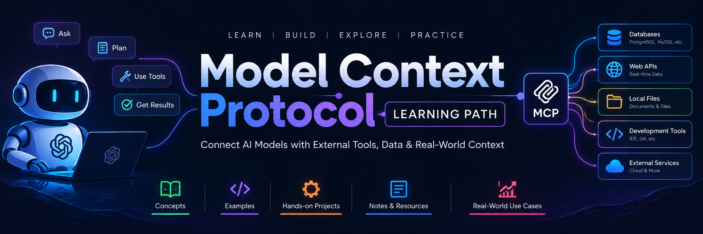
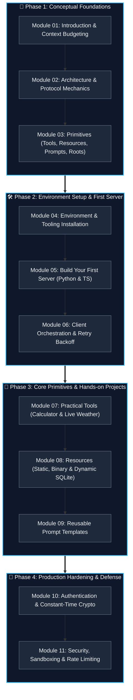

<p align="center">
  
</p>

<p align="center">
  <a href="https://github.com/swapnil3104/Model-Context-Protocol-Learning-Path">
    
  </a>
</p>

<p align="center">
  <a href="https://modelcontextprotocol.io/"></a>
  <a href="https://www.python.org/"></a>
  <a href="https://www.typescriptlang.org/"></a>
  <a href="./LICENSE"></a>
  <a href="./INDEX.md"></a>
  <a href="./CONTRIBUTING.md"></a>
</p>

---

## 🎯 Overview & Learning Objective

The **Model Context Protocol (MCP)** is an open standard introduced by Anthropic that standardizes how Large Language Model (LLM) applications connect to external tools, databases, local filesystems, dynamic prompt templates, and enterprise backends.

This repository provides a **comprehensive, production-grade developer curriculum** designed to take you from initial concepts to building, testing, securing, and deploying enterprise-ready MCP servers and clients in both **Python** and **TypeScript**.

> **Learning Goal:** By completing this learning path, you will understand how to design and deploy compliant MCP servers and clients, implement the 5 protocol primitives (*Tools, Resources, Prompts, Sampling, Roots*), secure servers with constant-time authentication and rate limiting, and seamlessly connect Claude Desktop, Cursor AI, VS Code, and custom autonomous agents to real-world context.

---

## 🧭 Start Here: Beginner's Onboarding Guide

New to MCP? Follow this structured path to get the most out of your journey:

```
[Prerequisites] ➔ [1. Conceptual Basics] ➔ [2. Setup & First Server] ➔ [3. Primitives & Projects] ➔ [4. Production Hardening]
```

### 1. Prerequisites
- **Programming Knowledge:** Familiarity with Python (async/await) or modern JavaScript/TypeScript (Node.js ES Modules).
- **Environment:**
  - Python 3.10+ installed (`python --version`)
  - Node.js 18+ installed (`node --version`)
  - A modern IDE (VS Code or Cursor recommended)
- **Supported Hosts (Optional but Recommended):**
  - [Claude Desktop](https://claude.ai/download) or Cursor AI or VS Code MCP Extension.

### 2. Recommended Reading Sequence
1. **Understand the Problem:** Read [Module 01: What is MCP?](./Module%2001%20Introduction/01%20What%20is%20MCP.md) to see how MCP replaces point-to-point connectors.
2. **Learn the Architecture:** Review [Module 02: Architecture & Protocol Flow](./Module%2002%20-%20MCP%20Architecture/README.md) for Host-Client-Server mechanics and latency modeling.
3. **Setup Your Workspace:** Follow the step-by-step [Module 04: Installation Guide](./Module%2004%20-%20Installation/Installation.md).
4. **Build Your First Server:** Launch your first server in under 5 minutes with [Module 05: Build Your First Server](./Module%2005%20-%20Setting%20Up%20Your%20First%20MCP%20Server/README.md).
5. **Dive into Primitives & Security:** Progress systematically through Tools, Resources, Prompts, Authentication, and Sandboxing.

---

## 🚀 Why Learn MCP?

Before MCP, connecting AI models to private tools and enterprise datasets required custom, ad-hoc integrations for every model-tool pair:

$$\text{Integration Complexity} = N \times M$$

where $N$ is the number of AI models or hosts and $M$ is the number of tools and databases.

| Legacy Point-to-Point Architecture | Universal MCP Standard Architecture |
|---|---|
| ❌ Bespoke connectors for each model | ✅ Single standardized protocol interface ($N + M$ complexity) |
| ❌ Models given raw credentials and socket access | ✅ Strict capability negotiation and security boundaries |
| ❌ Brittle prompt engineering for tool contracts | ✅ Validated JSON Schema definitions over JSON-RPC 2.0 |
| ❌ High maintenance overhead and vendor lock-in | ✅ Write once; run in Claude Desktop, Cursor, VS Code, & custom agents |

### 👥 Who Is This Learning Path For?

<table>
  <tr>
    <td width="33%" align="center">
      <br />
      <b>AI & Agent Engineers</b><br />
      Equip LLMs with reliable database access, web search, code execution, and autonomous multi-hop reasoning.
    </td>
    <td width="33%" align="center">
      <br />
      <b>Full-Stack Developers</b><br />
      Build and monetize standardized MCP servers in Node.js/TypeScript or Python FastMCP for developer ecosystems.
    </td>
    <td width="33%" align="center">
      <br />
      <b>DevOps & Security Engineers</b><br />
      Harden AI tool boundaries against timing attacks, prompt injections, directory traversals, and rate limit exhaustion.
    </td>
  </tr>
</table>

---

## 🗺️ Visual Learning Roadmap

The curriculum is structured into four progressive stages, matching the actual folders and modules in this repository:



---

## ⚡ Quick Start: Running Your First Server in 3 Minutes

Test a fully functional MCP server immediately using the code already in this repository!

### 1. Verify Prerequisites
```bash
python --version   # Must be >= 3.10
node --version     # Must be >= 18.0.0
```

### 2. Run the Calculator Server (Python FastMCP)
```bash
# Navigate to Calculator Python project
cd "Module 07 - Tools/01-Calculator/Python"

# Run the server directly
python server.py
```

### 3. Run the Calculator Server (TypeScript SDK)
```bash
# Navigate to Calculator TypeScript project
cd "Module 07 - Tools/01-Calculator/TypeScript"

# Install dependencies and build
npm install
npm run build

# Start the server over STDIO
node dist/server.js
```

### 4. Connect to Claude Desktop or Cursor AI
Add this entry to your host configuration file (e.g. `%APPDATA%\Claude\claude_desktop_config.json` on Windows or `~/Library/Application Support/Claude/claude_desktop_config.json` on macOS):

```json
{
  "mcpServers": {
    "calculator-python": {
      "command": "python",
      "args": ["E:/Model-Context-Protocol-Learning-Path/Module 07 - Tools/01-Calculator/Python/server.py"]
    },
    "calculator-typescript": {
      "command": "node",
      "args": ["E:/Model-Context-Protocol-Learning-Path/Module 07 - Tools/01-Calculator/TypeScript/dist/server.js"]
    }
  }
}
```

### 5. Inspect Interactively with MCP Inspector
Use the official browser-based MCP Inspector tool to explore schemas and invoke methods:
```bash
npx @modelcontextprotocol/inspector node "Module 07 - Tools/01-Calculator/TypeScript/dist/server.js"
```

---

## 📚 Master Learning Index & Curriculum

For the exhaustive lesson-by-lesson syllabus, prerequisites, and concepts breakdown, visit the **[Master Learning Index (INDEX.md)](./INDEX.md)**.

| Module | Title | Level | Core Focus | Direct Lesson Links |
| :---: | :--- | :---: | :--- | :--- |
| **01** | **Introduction** | `Beginner` | Protocol Foundations & Context Budgeting | [Overview](./Module%2001%20Introduction/00%20Overview.md) • [What is MCP?](./Module%2001%20Introduction/01%20What%20is%20MCP.md) • [Context in AI](./Module%2001%20Introduction/07%20Context%20in%20Modern%20AI%20Systems.md) |
| **02** | **MCP Architecture** | `Beginner` | Protocol Design, Latency & Transports | [Architecture Guide](./Module%2002%20-%20MCP%20Architecture/README.md) • [Latency Modeling](./Module%2002%20-%20MCP%20Architecture/README.md#transport-performance--latency-modeling) |
| **03** | **MCP Components** | `Intermediate` | Tools, Resources, Prompts, Sampling & Roots | [Components Hub](./Module%2003%20-%20MCP%20Components/README.md) • [Tools Theory](./Module%2003%20-%20MCP%20Components/01%20MCP%20Tools/01_MCP%20Tools%20-%20Theory.md) • [Roots & Advanced](./Module%2003%20-%20MCP%20Components/06-Roots-and-Advanced-Capabilities/README.md) |
| **04** | **Installation** | `Beginner` | Python, Node.js, Docker, Claude & Cursor Setup | [Complete Installation Guide](./Module%2004%20-%20Installation/Installation.md) |
| **05** | **First MCP Server** | `Beginner` | Hands-on SDK Implementation | [Server Guide](./Module%2005%20-%20Setting%20Up%20Your%20First%20MCP%20Server/README.md) • [TS Starter](./Module%2005%20-%20Setting%20Up%20Your%20First%20MCP%20Server/02-Installing-MCP-SDK/my-first-mcp-server/src/server.ts) • [Python Starter](./Module%2005%20-%20Setting%20Up%20Your%20First%20MCP%20Server/02-Installing-MCP-SDK/my-python-mcp/server.py) |
| **06** | **MCP Client** | `Intermediate` | Client Architecture & Retry Backoff | [Client Guide](./Module%2006%20-%20Client/README.md) • [Client Theory](./Module%2006%20-%20Client/01_MCP%20Client%20-%20Theory.md) • [Message Flow](./Module%2006%20-%20Client/03_MCP%20Client%20-%20Flow.md) |
| **07** | **MCP Tools** | `Intermediate` | Real-World Tool Implementations | [Tools Hub](./Module%2007%20-%20Tools/README.md) • [Calculator](./Module%2007%20-%20Tools/01-Calculator/README.md) • [Weather Service](./Module%2007%20-%20Tools/02-Weather/README.md) |
| **08** | **Resources** | `Intermediate` | Static Files, Dynamic DB, Binary Blobs | [Resources Hub](./Module%2008%20-%20Resources/README.md) • [Theory](./Module%2008%20-%20Resources/Theory.md) • [Python Server](./Module%2008%20-%20Resources/Python/server.py) • [TS Server](./Module%2008%20-%20Resources/TypeScript/server.ts) |
| **09** | **Prompt Templates** | `Intermediate` | Parameterized Prompts & Workflows | [Prompts Hub](./Module%2009%20-%20Prompt%20Templates/README.md) • [Theory](./Module%2009%20-%20Prompt%20Templates/Theory.md) • [Python Server](./Module%2009%20-%20Prompt%20Templates/Python/server.py) • [TS Server](./Module%2009%20-%20Prompt%20Templates/TypeScript/server.ts) |
| **10** | **Authentication** | `Advanced` | Secret Isolation & Constant-Time Crypto | [Auth Hub](./Module%2010%20-%20Authentication/README.md) • [Timing Guide](./Module%2010%20-%20Authentication/Theory.md) • [TS Server](./Module%2010%20-%20Authentication/TypeScript/server.ts) |
| **11** | **Security & Sandboxing**| `Advanced` | Path Traversal Defense & Token Bucket | [Security Hub](./Module%2011%20-%20Security/README.md) • [Token Bucket](./Module%2011%20-%20Security/Theory.md) • [Python Server](./Module%2011%20-%20Security/Python/server.py) |

---

## 🛠️ Hands-on Practice & Project Showcases

Explore real, working reference servers in this repository:

- 🧮 **[01-Calculator Server](./Module%2007%20-%20Tools/01-Calculator/README.md):** Complete implementation of arithmetic tools (`add`, `subtract`, `multiply`, `divide`, `power`, `sqrt`, `modulus`) with division-by-zero validation in both Python FastMCP and TypeScript.
- 🌦️ **[02-Weather Service Server](./Module%2007%20-%20Tools/02-Weather/README.md):** Live REST API client tool that queries weather data, formats responses, and handles HTTP rate limits and timeout failures gracefully.
- 📁 **[Static & Dynamic Resources](./Module%2008%20-%20Resources/README.md):** Demonstrates static text, markdown docs, base64-encoded PDF & PNG binaries, CSV tabular streams, and parameterized SQLite dynamic query templates (`db://users/{id}`).
- 💬 **[Server-Side Prompts](./Module%2009%20-%20Prompt%20Templates/README.md):** Enterprise prompt templates including standard `code_review` (with strictness levels) and `summarize_text` with parameter schema enforcement.
- 🔑 **[Constant-Time Authenticated Server](./Module%2010%20-%20Authentication/README.md):** Production security server implementing constant-time XOR comparison to protect API tokens against timing side-channel attacks.
- 🛡️ **[Sandboxed Security Server](./Module%2011%20-%20Security/README.md):** Path traversal validation engine and token-bucket algorithm limiting client requests per second.

---

## 🎁 MCP Developer Gifts & Reference Cheat Sheets

### 1. 📋 Core Protocol Primitives Comparison Cheat Sheet

| Feature | `Tools` | `Resources` | `Prompts` | `Sampling` |
|---|---|---|---|---|
| **Initiated By** | LLM / Host | LLM / Host | User / Host | Server |
| **Primary Purpose** | Dynamic Execution / Action | Passive / Read-Only Context | Instruction Template | Server-initiated Generation |
| **Side Effects?** | Yes (Mutations, DB writes, APIs) | No (Strictly read-only) | No | No |
| **JSON-RPC Methods** | `tools/list`, `tools/call` | `resources/list`, `resources/read` | `prompts/list`, `prompts/get` | `sampling/createMessage` |
| **Example Use Case** | Calculator, Weather, Git commit | File reader, DB schema, log feed | Code Review, PR Summarizer | Multi-agent recursive reasoning |

### 2. ⚡ Protocol Error Codes Cheat Sheet

Standard JSON-RPC 2.0 error codes handled across MCP clients and servers:

| Code | Error Name | Meaning & Typical Cause |
|:---:|---|---|
| `-32700` | **Parse Error** | Invalid JSON received by the server. |
| `-32600` | **Invalid Request** | Sent payload is not a valid JSON-RPC 2.0 request. |
| `-32601` | **Method Not Found** | Method not registered on server (e.g. host lacks sampling capability). |
| `-32602` | **Invalid Params** | Arguments failed JSON Schema validation. |
| `-32603` | **Internal Error** | Uncaught exception or server runtime crash. |
| `-32000` to `-32099` | **Server Error** | Reserved for implementation-defined server errors (e.g. rate limits). |

> [!TIP]
> **Tool Execution Errors vs. Protocol Errors:** When a tool execution fails (e.g., city not found or division by zero), return a valid JSON-RPC result containing `isError: true` inside the content payload rather than raising a protocol-level JSON-RPC exception. This allows the LLM to inspect the error message and recover autonomously!

### 3. 🎯 Mini Project Challenges

Put your knowledge into practice with these hands-on milestones:
- 🟢 **Beginner Challenge:** Build a `SystemInfo` MCP tool in Python that returns CPU, RAM, and OS uptime in formatted Markdown.
- 🟡 **Intermediate Challenge:** Create a `GitInspector` MCP server in TypeScript that exposes repository commits as dynamic resources and provides a `create_branch` tool.
- 🔴 **Advanced Challenge:** Implement an enterprise `OAuth2Proxy` server with token-bucket rate limiting and strict Human-in-the-Loop confirmation before write operations.

### 4. 📖 Core MCP Glossary

- **Host:** The user-facing application coordinating the AI model (e.g. Claude Desktop, Cursor AI, VS Code, custom multi-agent app).
- **Client:** The protocol adapter inside the Host maintaining a 1:1 connection with an MCP server.
- **Server:** A lightweight process or service providing tools, resources, and prompts over standard transports.
- **STDIO Transport:** Standard input/output communication for local sub-processes.
- **Streamable HTTP / SSE:** HTTP POST paired with Server-Sent Events for remote networked servers.
- **Resource Template:** A parameterized URI (`sql://orders/{order_id}`) resolved dynamically by the server.
- **Sampling:** A protocol capability enabling servers to request LLM completions back through the host.
- **Roots:** Client-defined filesystem boundary boundaries restricting server actions.

### 5. ❓ FAQs & Learner Self-Assessment
Looking for answers to common architectural dilemmas or want to evaluate your knowledge?
👉 **[Open Comprehensive FAQ & 20-Question Self-Assessment (FAQ-and-Self-Assessment.md)](./FAQ-and-Self-Assessment.md)** covering all 11 modules with detailed answer keys!

---

## 📊 Learner Progress Checklist

Track your journey through the 4 stages of the curriculum:

- [ ] **Stage 1: Foundations**
  - [ ] Understand why MCP solves $N \times M$ integration complexity ([Module 01](./Module%2001%20Introduction/01%20What%20is%20MCP.md))
  - [ ] Master Host, Client, and Server architectural roles ([Module 02](./Module%2002%20-%20MCP%20Architecture/README.md))
  - [ ] Understand the 5 core primitives: Tools, Resources, Prompts, Sampling, Roots ([Module 03](./Module%2003%20-%20MCP%20Components/README.md))
- [ ] **Stage 2: Setup & Construction**
  - [ ] Setup Python, Node.js, and host applications ([Module 04](./Module%2004%20-%20Installation/Installation.md))
  - [ ] Launch your first MCP Server in Python and TypeScript ([Module 05](./Module%2005%20-%20Setting%20Up%20Your%20First%20MCP%20Server/README.md))
  - [ ] Grasp client message lifecycle and exponential backoff ([Module 06](./Module%2006%20-%20Client/README.md))
- [ ] **Stage 3: Hands-on Practice**
  - [ ] Test the Calculator and Weather MCP tool servers ([Module 07](./Module%2007%20-%20Tools/README.md))
  - [ ] Expose text, binary, and SQLite database resources ([Module 08](./Module%2008%20-%20Resources/README.md))
  - [ ] Create reusable server-side prompt templates ([Module 09](./Module%2009%20-%20Prompt%20Templates/README.md))
- [ ] **Stage 4: Production Hardening**
  - [ ] Implement constant-time authentication to stop timing attacks ([Module 10](./Module%2010%20-%20Authentication/README.md))
  - [ ] Enforce path traversal sandboxes and token-bucket rate limiting ([Module 11](./Module%2011%20-%20Security/README.md))

---

## 🔗 Authoritative References & Documentation

- 🌐 [Official Model Context Protocol Specification](https://spec.modelcontextprotocol.io/)
- 📘 [Official MCP Documentation & Quickstarts](https://modelcontextprotocol.io/)
- 💻 [Official TypeScript SDK (`@modelcontextprotocol/sdk`)](https://github.com/modelcontextprotocol/typescript-sdk)
- 🐍 [Official Python SDK (`mcp`)](https://github.com/modelcontextprotocol/python-sdk)
- 🔍 [Official MCP Inspector Tool](https://github.com/modelcontextprotocol/inspector)
- 🗂️ [Anthropic Pre-Built Reference MCP Servers](https://github.com/modelcontextprotocol/servers)

---

## 🤝 Contributing & Community

Contributions are warmly welcomed! Whether you are fixing typos, improving documentation, adding new sample servers, or enhancing test coverage:
1. Check our [Contribution Guidelines (CONTRIBUTING.md)](./CONTRIBUTING.md).
2. Fork the repository, create your feature branch, and submit a PR.
3. Help build the standard ecosystem for LLM extensibility!

---

## 📄 License

This project is licensed under the **[MIT License](./LICENSE)** — see the LICENSE file for details.

---

<p align="center">
  <b>⭐ If you find this learning path helpful, please star the repository! ⭐</b><br />
  <sub>Built with ❤️ for the global AI and MCP developer community.</sub>
</p>
